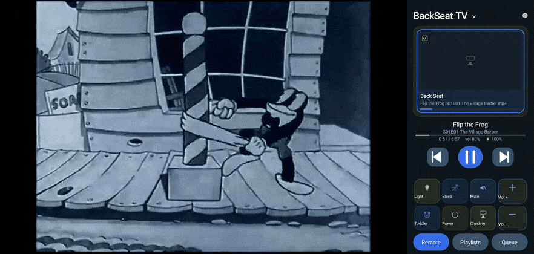

# BackSeat TV

[](../../actions/workflows/android-ci.yml)

A self-contained, **fully offline** in-car and multi-screen media appliance. An Android tablet is
locked down as a **device-owner kiosk** that boots straight into a shuffle of local media —
no launcher, no menus to escape into, no internet, no ads — and is driven from a phone, a
smartwatch, or the car's Android Auto screen. Multiple screens can be driven at once, either
**independently** or **synced frame-to-frame** so several show the same thing in step.

Built as a real appliance for real drives, then hardened into a portfolio piece: one cohesive
Android app, unit-tested core logic, CI, and no cloud anywhere. It's a personal project that my family
uses every day, not a commercial product. You bring your own videos.

> **Name:** the code and package still say *Anancy*, the project's codename: the
> **storyteller spider** of West African and Caribbean folklore, who owns all the world's stories.

## Demo

<!-- TODO(owner): drop a screen recording here — phone remote driving two tablets in sync.
     See docs/README.md for how to record the clip, convert it, and drop it in
     (save it as docs/demo.gif and swap this comment for: ). -->
_A 20-second clip of the phone remote driving two screens in lock-step will go here._

## What makes it interesting

- **Clock-aligned multi-device playback.** Followers estimate the leader's monotonic clock
  with an NTP-lite offset (lowest-RTT filtered, slow-drift tracked), extrapolate where the
  leader is *now*, and converge with a seek-ahead scheduled start plus an inaudible ±1.5%
  speed nudge. Measured to ~20–50 ms apart on real hardware. The math is pure and
  unit-tested: [`player/SyncMath.java`](anancy/app/src/main/java/app/anancy/player/SyncMath.java).
- **Its own EOF-proof player.** A Media3 (ExoPlayer) engine with native shuffle-all +
  deterministic auto-advance, so the "stuck at end-of-file" wedge that plagued the old
  Kodi build structurally cannot happen — no watchdog needed.
- **Device-owner kiosk done properly.** Lock-task mode, boot-into-show as the home screen,
  a hidden gesture + PIN admin escape, self-granted permissions, and a self-update path
  that even pushes the watch build over the Bluetooth Data Layer.
- **Two transports, one control plane.** BLE is primary (works with no network at all);
  Wi-Fi/mDNS runs alongside for higher bandwidth and for screens that don't advertise BLE.
  A **pull model** (the phone is a passive bulletin the tablet polls) sidesteps the
  Wi-Fi Direct single-radio + directional-firewall problem.
- **Correct command routing.** In a synced group, playback drives the leader alone
  (followers mirror) while per-screen actions (power/light/sleep/volume) hit every member —
  the split is pure and unit-tested:
  [`remote/CommandRouter.java`](anancy/app/src/main/java/app/anancy/remote/CommandRouter.java).
- **Four control surfaces** from one app: an in-tablet admin remote, a phone remote, a
  Wear OS remote, and an Android Auto media dash. The watch follows the phone: it drives whatever
  the phone remote is aimed at, including several screens at once.
- **A remote can also be a screen.** Tick one box and the phone plays the show in a card inside the
  remote, joins synced groups, and can go fullscreen with the same engine still running.

## Architecture

One APK, two roles (chosen on first run and remembered): **player** (the tablet kiosk) and
**remote** (the phone), which can optionally be a player as well. The same code ships both.

```
        Phone / Watch / Android Auto  ──BLE (primary)──┐
                    (remote role)      ──Wi-Fi/mDNS─────┤
                                                        ▼
                                            Tablet kiosk (player role)
                                            ┌───────────────────────────┐
                                            │ ControlServer  :8090 HTTP  │
                                            │ BleServer      GATT        │
                                            │        │                   │
                                            │        ▼                   │
                                            │ PlayerController ─ ExoPlayer│
                                            │  (queue, sync, volume)     │
                                            └───────────────────────────┘
   Synced group: one leader plays; followers poll /clock + /state and mirror in lock-step.
```

Inside `anancy/app` the code is grouped by concern (package root `app.anancy`):

| Package | Responsibility |
|---------|----------------|
| `player/` | ExoPlayer engine, queue/playlists, the clock-sync math, media session |
| `remote/` | Phone remote UI + service, command routing, settings/about screens |
| `net/`    | HTTP control server, BLE server/client, Wi-Fi client, hotspot, QR pairing, camera snapshot |
| `admin/`  | Device-owner receiver, unlock gesture, boot + package-replaced receivers |
| _(root)_  | Launcher/role router and the small shared core (`Cfg`, `Identity`) |

## Repo layout

| Path | What it is | State |
|------|------------|-------|
| [`anancy/`](anancy/) | **The app.** `:app` (phone + tablet) and `:wear` (Wear OS). Gradle. | Production |
| [`camera-monitor/`](camera-monitor/) | Front-cam + ML Kit still-image child monitor. Gradle. | Prototype |
| [`install/`](install/) | One-step Windows setup script for a fresh tablet. | Production |
| [`server/`](server/) | Home-server helper scripts (media sync over adb). | Utility |
| [`legacy/`](legacy/) | v1 (Kodi-bridge) apps + v2 prototypes, superseded. Not built. | Archived |

## Install & setup

See **[SETUP.md](SETUP.md)**: a no-computer route (download the APK, screen pinning), an adb route
(device-owner kiosk, watch remote, Android Auto without the developer toggle), and a one-step Windows
script that does the adb route for you.

## Build & test

The app is a standard Gradle project (Java 17, Android SDK build-tools 35 / platform 35).
`local.properties` is gitignored; set `ANDROID_SDK_ROOT` or add your own.

```bash
cd anancy
gradle :app:testDebugUnitTest     # run the unit tests (SyncMath, CommandRouter)
gradle :app:assembleDebug         # build the APK (also builds + embeds the watch app)
gradle assembleRelease            # signed release APKs (needs a key: see anancy/signing.gradle)
```

CI runs both on every push — see [`.github/workflows/android-ci.yml`](.github/workflows/android-ci.yml).

_(The archived `legacy/` apps use a no-Gradle `./build.sh`; they're kept only for history.)_

## Status & Android compatibility

**v1.0.0.** Tested on a Samsung SM-T575 and a Lenovo TB-X606F tablet, a Galaxy S21, a Galaxy Watch
and a real Android Auto car. Other hardware may need adjusting. Android-TV-as-a-follower is
exploratory, and a Play Store version of the phone app is planned for v1.1.

The kiosk ships via GitHub / EMM (device-owner can't come from the Play Store), and targets
**API 35** (Android 15). Modern-platform items handled:

- **targetSdk / compileSdk 35** (app + watch) — ready for a Play Store submission.
- **16 KB page-size**: CameraX 1.4.1 and ML Kit barcode 17.3.0 ship 16 KB-aligned native
  libs, so the QR scanner / camera load on 16 KB-page Android 15+ devices.
- **Edge-to-edge**: opted out via `windowOptOutEdgeToEdgeEnforcement` for now (a supported
  API-35 stopgap); a full `WindowInsets` pass is the proper follow-up.

Still on the list: promoting `HotspotService` to a typed foreground service (works today
via the device-owner exemption), and on-device verification on a physical Android 15 unit.

## Contributing

This is a personal portfolio project — issues and pull requests aren't being accepted. You're welcome to fork it under the license below.

## License

**PolyForm Noncommercial 1.0.0** (see [`LICENSE.md`](LICENSE.md)): free for any
non-commercial use; commercial use requires a separate license from the copyright holder.
Source-available, not OSI "open source."
